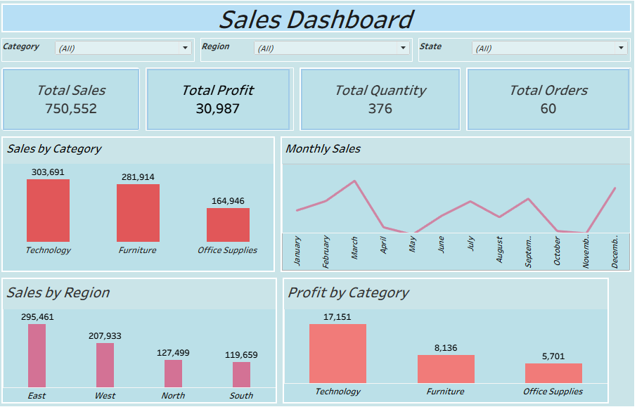

# 📊 Sales Dashboard – Tableau

## 📌 Project Overview
This project is an interactive Sales Dashboard built using Tableau to analyze sales performance, profit, quantity sold, and orders across different categories, regions, states, and months.

The dashboard helps users understand sales trends, compare category and regional performance, and explore business data using interactive filters.

## 🎯 Objectives
- Analyze total sales, profit, quantity, and orders.
- Compare sales performance across product categories.
- Understand monthly sales trends.
- Analyze sales and profit across different regions.
- Provide interactive filters for better data exploration.

## 📈 Key Performance Indicators (KPIs)
- **Total Sales:** 750,552
- **Total Profit:** 30,987
- **Total Quantity:** 376
- **Total Orders:** 60

## 📊 Dashboard Visualizations
- Sales by Category
- Monthly Sales Trend
- Sales by Region
- Profit by Category

## 🎛️ Interactive Filters
- Category
- Region
- State

These filters allow users to interact with the dashboard and explore sales performance for different categories, regions, and states.

## 🔍 Key Insights
- Technology has the highest sales among the three product categories.
- Furniture has the second-highest sales.
- Office Supplies has the lowest sales.
- East region contributes the highest sales among the four regions.
- Technology generates the highest profit among all categories.
- Monthly sales fluctuate throughout the year.

## 🛠️ Tools Used
- Tableau
- Data Visualization
- Dashboard Design
- KPI Analysis
- Interactive Filters

## 📷 Dashboard Preview

## 👩‍💻 Author
Created as a Data Analyst portfolio project to practice data visualization, KPI analysis, and interactive dashboard development using Tableau.
